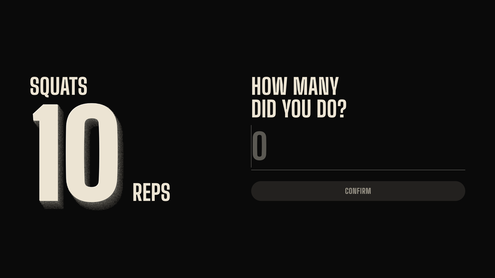
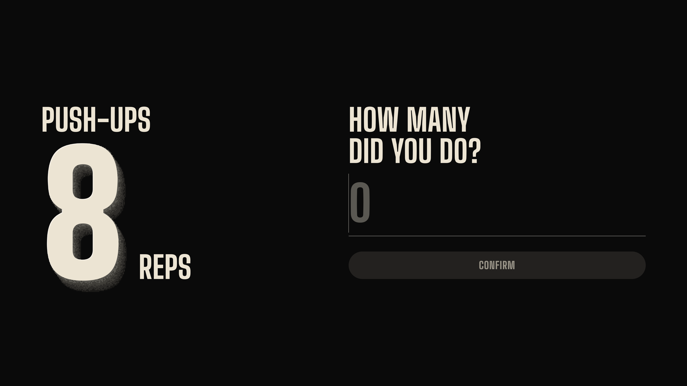
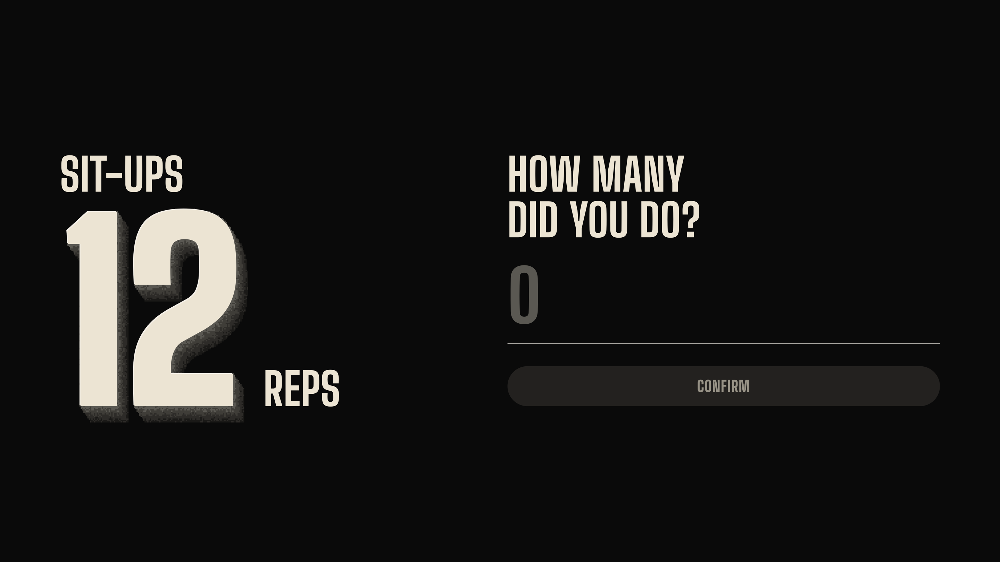
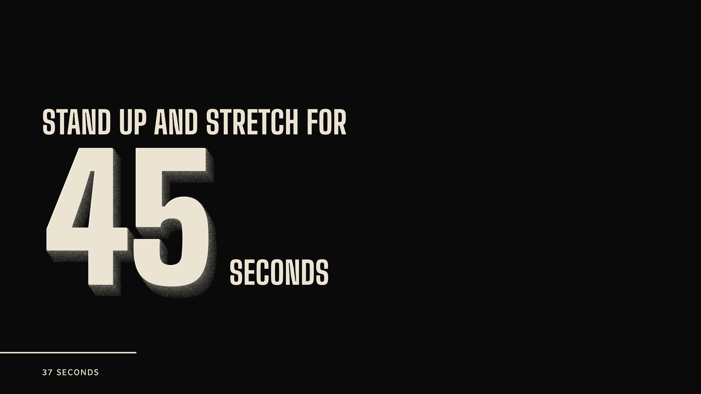
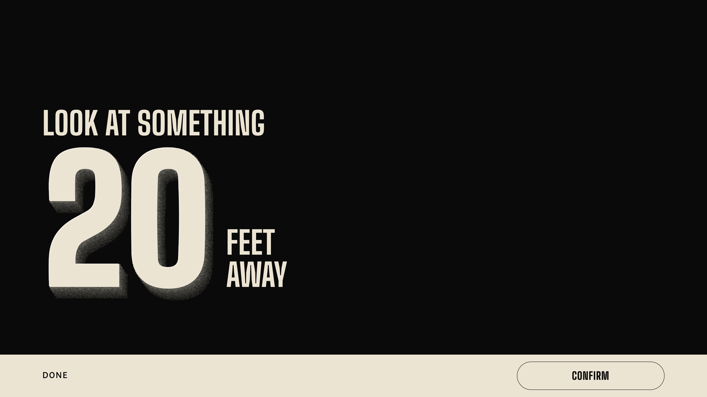
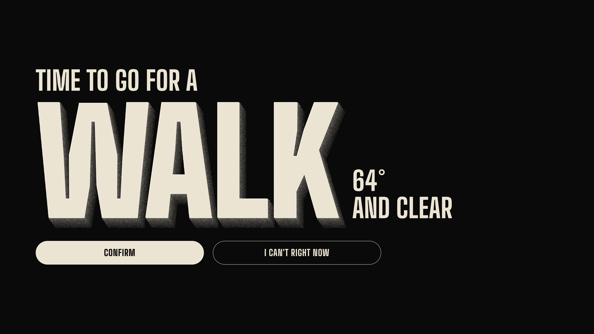
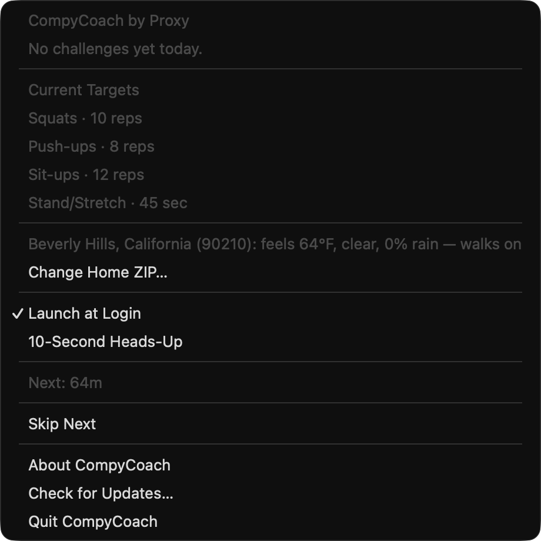

# CompyCoach



Sitting all day slowly folds you into the shape of your chair. CompyCoach lives in your Mac's menu bar and, every hour or so, takes over the screen with something small to do: a few squats, a stretch, a walk around the block. Do it, tap Confirm, and get back to work. Each time you keep up, it asks for a little more.

**[Download CompyCoach for Mac](https://github.com/designbyproxy/CompyCoach/releases/latest/download/CompyCoach.dmg)** · Free · macOS 13 (Ventura) or later · Apple silicon and Intel

## What a break looks like

When a break comes due, CompyCoach fills your screen with one clear ask. There's no window to minimize and nothing to snooze, so the easiest way back to work is to do the thing.

| | |
|---|---|
|  |  |
| **Reps.** Squats, push-ups, and sit-ups ask how many you did. Type the number and press Return. | Your answer sets the next target. Hit it most of the week and the number climbs. Miss it and it eases off. |
|  |  |
| **Timed breaks.** A stretch or an eye break counts itself down along the bottom of the screen... | ...and Confirm shows up once the time's done. The eye break follows the 20-20-20 rule: every so often, look 20 feet away for 20 seconds. |



**Walks.** Once a day it suggests a walk, with the weather at home alongside. Not a good moment? Tap "I can't right now" and a desk exercise takes its place in 10 to 15 minutes, with the walk coming back once a couple of hours later. Pass on it again and that's it for the day.

## It picks its moments

CompyCoach counts down active time at the keyboard, and the countdown sits still whenever interrupting you would be rude or pointless:

- **On a call.** If another app is using your camera or microphone, or someone is screen sharing with you, it waits until you hang up.
- **Away from your desk.** After 10 minutes without a keystroke or mouse move it pauses, and it doesn't count the time you were gone. Reading or watching something for a few minutes still counts as being at your desk. If a break comes due after you've been still for 2 minutes, it waits for you to come back.
- **Asleep.** Closing the lid pauses it too.

When you come back from a pause, you get at least 2 minutes before a break can start, so it never pounces the second you sit down. That cushion comes once per break, so stepping in and out can't keep pushing a break back. Breaks land somewhere between 45 and 75 minutes apart.

**Walks wait for decent weather.** Add your ZIP code from the menu and CompyCoach skips the walk when it feels colder than 45°F, when it's raining or snowing, or when rain looks likely in the next hour. It offers the walk again later that day once things clear up. Without a ZIP, walks are always on the table.

**Want a warning first?** Turn on **10-Second Heads-Up** in the menu and a small countdown appears in the corner of your screen before each break.

## Install

1. [Download CompyCoach.dmg](https://github.com/designbyproxy/CompyCoach/releases/latest/download/CompyCoach.dmg), open it, and drag **CompyCoach** into **Applications**.
2. Open CompyCoach from your Applications folder. macOS will say it can't check the app for malicious software, because CompyCoach is a free side project without a paid Apple developer certificate. Click **Done**.
3. Open **System Settings → Privacy & Security**, scroll down to the message about CompyCoach, and click **Open Anyway**. Confirm with your password or Touch ID.

You only do this once. After that, CompyCoach opens like any other app. Look for its icon in the menu bar at the top right of your screen.

To have it start when you log in, choose **Launch at Login** from its menu. (This only works once the app is in your Applications folder.)

**Prefer Terminal?** This replaces steps 2 and 3:

```bash
xattr -dr com.apple.quarantine /Applications/CompyCoach.app
```

## The menu

Click the icon in the menu bar to see:



- **Today's tally** and your **current targets**
- **Next:** how long until the next break, or why it's paused
- **Set Home ZIP for Walk Weather…**
- **Launch at Login** and **10-Second Heads-Up**
- **Skip Next** to push the next break back a full interval
- **About CompyCoach** and **Quit**

## How targets change

After a squat, push-up, or sit-up break, CompyCoach looks at your last 7 days of that exercise and adjusts the target at most once a day:

- Hit the target **80% of the time or more** and it goes up about 10% (always at least one rep).
- Hit it **half the time or less** and it comes down about 10%.
- Anywhere in between, it stays put.

Starting targets are 10 squats, 8 push-ups, and 12 sit-ups. Targets never drop below 5 squats, 4 push-ups, or 5 sit-ups. Stretches stay at 45 seconds and eye breaks at 20.

## Privacy

CompyCoach has no account, no analytics, and no tracking. Your log and targets stay on your Mac in `~/Library/Application Support/CompyCoach/`.

The app only goes online for walk weather, and only if you add a ZIP code. It sends the ZIP to [Open-Meteo](https://open-meteo.com) once to look up your coordinates, then sends those coordinates to check the forecast, at most every 30 minutes.

Call detection runs entirely on your Mac. CompyCoach checks *whether* the camera or microphone is in use. It never opens either one.

## Uninstall

Quit CompyCoach from its menu, drag it from Applications to the Trash, and delete `~/Library/Application Support/CompyCoach/` if you want your history gone too.

---

## For developers

Requires a recent Xcode.

| Script | What it does |
|---|---|
| `scripts/package.sh` | Builds a Release copy and writes `build/CompyCoach.dmg`, ready to attach to a GitHub release. |
| `scripts/make-screenshots.sh` | Recaptures every image in `docs/screenshots/` from a debug build. Each takeover fills your screen for a few seconds while it runs. Pass names (`walk eyes`) to redo just those. |
| `scripts/make-icons.swift` | Regenerates the app and menu bar icons from `logo.svg`. |

Debug builds add test buttons to the bottom of the menu (Trigger Panel, Trigger Walk, Seed Test Data, and so on). The log in `~/Library/Application Support/CompyCoach/log.json` is append-only, one JSON object per line. `targets.json` holds the current targets.

To publish a release, run `scripts/package.sh`, then:

```bash
gh release create v1.0 build/CompyCoach.dmg --title "CompyCoach 1.0" --notes "…"
```

The download links above always point at the newest release's `CompyCoach.dmg`.

---

Designed by [Proxy](https://designbyproxy.com).
